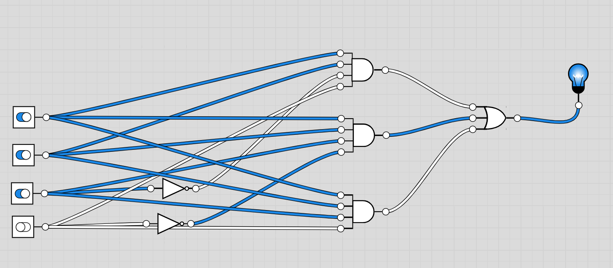
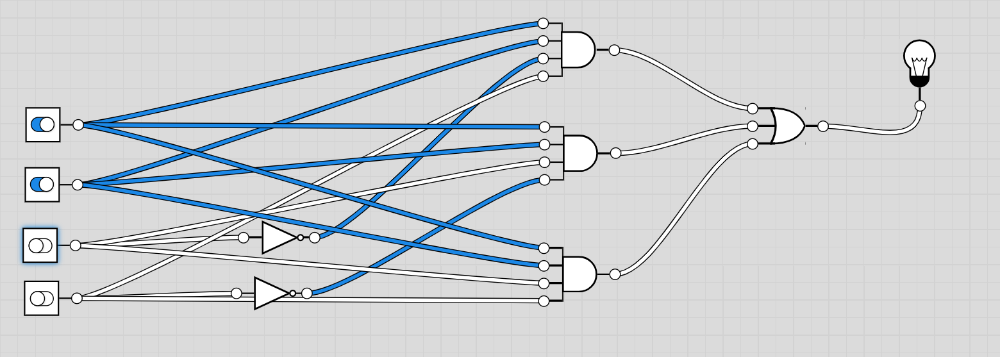

# Global Solution GS26_2 — Citizen Assist AI
**Curso:** Bacharelado em Ciência da Computação | **Ano:** 1º | **Turma:** 1CC  
**Disciplina:** Computer Science  
**Projeto:** Módulo de Decisão Lógica — Citizen Assist AI (Triagem e Orientação BPC/LOAS)  
**Equipe:** [Nome dos Integrantes — RM]

---

## 1. Descrição do Problema e Cenário de Atendimento

O projeto **Citizen Assist AI** visa fornecer assistência ágil, acessível e desburocratizada aos cidadãos brasileiros que buscam serviços públicos essenciais. Dentro desse ecossistema, o presente módulo de decisão lógica foi desenvolvido especificamente para orientar o cidadão quanto à elegibilidade preliminar ao **Benefício de Prestação Continuada (BPC / LOAS)**, bem como orientá-lo sobre a documentação exigida e os canais de agendamento.

### 1.1 Contexto do BPC / LOAS
O Benefício de Prestação Continuada é a garantia constitucional de um salário mínimo mensal à pessoa com deficiência e ao idoso com 65 (sessenta e cinco) anos ou mais que comprovem não possuir meios de prover a própria manutenção nem de tê-la provida por sua família. Por ser um benefício da assistência social, não exige contribuição prévia à Previdência Social.

### 1.2 Regra de Negócio Modelada
Para ter acesso inicial ao benefício, a legislação exige simultaneamente:
1. **Cadastro Único (CadÚnico):** Estar devidamente inscrito com informações atualizadas há no máximo 2 anos;
2. **Critério de Renda:** Possuir renda familiar mensal *per capita* igual ou inferior a $1/4$ do salário mínimo vigente;
3. **Público-Alvo:** Pertencer a pelo menos uma das duas categorias protegidas:
   - Ter idade igual ou superior a 65 anos; **OU**
   - Ser Pessoa com Deficiência (PcD) de impedimento de longo prazo (mínimo de 2 anos).

O objetivo do módulo lógico é cruzar essas condições binárias para definir a saída de orientação do assistente virtual:
- Se todos os critérios forem preenchidos ($S = 1$), o assistente instrui sobre os documentos e encaminha para formalização no INSS/CRAS.
- Se algum critério falhar ($S = 0$), o assistente diagnostica exatamente o motivo da inaptidão e direciona o cidadão para regularização ou outros programas sociais.

---

## 2. Definição das Variáveis Booleanas

Para representar computacionalmente a regra de triagem, foram estabelecidas 4 variáveis booleanas de entrada e 1 variável booleana de saída, todas com significados físicos e jurídicos estritos:

### 2.1 Variáveis de Entrada

| Variável | Descrição / Critério | Valor $0$ | Valor $1$ |
| :---: | :--- | :--- | :--- |
| **$A$** | **Inscrição no CadÚnico** | Sem cadastro ou dados desatualizados (> 2 anos) | Inscrito e com dados atualizados no CadÚnico |
| **$B$** | **Renda Familiar Per Capita** | Renda familiar por pessoa superior a $1/4$ do salário mínimo | Renda familiar por pessoa inferior ou igual a $1/4$ do salário mínimo |
| **$C$** | **Faixa Etária (Idoso)** | Cidadão possui menos de 65 anos de idade | Cidadão possui 65 anos de idade ou mais |
| **$D$** | **Pessoa com Deficiência (PcD)** | Não possui deficiência incapacitante de longo prazo | Possui deficiência física, mental, intelectual ou sensorial de longo prazo |

### 2.2 Variável de Saída

| Variável | Descrição / Orientação do Assistente | Valor $0$ (Não Elegível) | Valor $1$ (Elegível) |
| :---: | :--- | :--- | :--- |
| **$S$** | **Parecer e Encaminhamento** | Critérios não atendidos. O assistente aponta os impedimentos específicos e orienta regularização no CRAS. | Critérios atendidos. O assistente lista a documentação necessária e instrui agendamento no Meu INSS / CRAS. |

---

## 3. Tabela-Verdade Completa

Considerando as 4 variáveis de entrada, o sistema possui um espaço de estados de $2^4 = 16$ combinações possíveis. 

A saída $S$ assume valor lógico $1$ estritamente quando $A = 1$ e $B = 1$, acompanhados de $C = 1$ ou $D = 1$ (linhas 13, 14 e 15). Todas as demais combinações resultam em $S = 0$.

| Linha | Mintermo | $A$ (CadÚnico) | $B$ (Renda $\le 1/4$) | $C$ (Idoso $\ge 65$) | $D$ (PcD) | $S$ (Orientação) | Justificativa do Parecer |
| :---: | :---: | :---: | :---: | :---: | :---: | :---: | :--- |
| **0** | $m_0$ | 0 | 0 | 0 | 0 | **0** | Sem cadastro, sem critério de renda e fora do público-alvo |
| **1** | $m_1$ | 0 | 0 | 0 | 1 | **0** | É PcD, porém sem cadastro e renda excedente |
| **2** | $m_2$ | 0 | 0 | 1 | 0 | **0** | É idoso, porém sem cadastro e renda excedente |
| **3** | $m_3$ | 0 | 0 | 1 | 1 | **0** | É idoso e PcD, mas sem cadastro e renda excedente |
| **4** | $m_4$ | 0 | 1 | 0 | 0 | **0** | Renda compatível, mas sem CadÚnico e fora do público-alvo |
| **5** | $m_5$ | 0 | 1 | 0 | 1 | **0** | Renda compatível e PcD, mas falta CadÚnico obrigatório |
| **6** | $m_6$ | 0 | 1 | 1 | 0 | **0** | Renda compatível e Idoso, mas falta CadÚnico obrigatório |
| **7** | $m_7$ | 0 | 1 | 1 | 1 | **0** | Renda, Idoso e PcD, mas falta CadÚnico obrigatório |
| **8** | $m_8$ | 1 | 0 | 0 | 0 | **0** | Possui CadÚnico, porém renda excede $1/4$ SM e fora do público |
| **9** | $m_9$ | 1 | 0 | 0 | 1 | **0** | CadÚnico e PcD, porém renda per capita acima do teto legal |
| **10** | $m_{10}$ | 1 | 0 | 1 | 0 | **0** | CadÚnico e Idoso, porém renda per capita acima do teto legal |
| **11** | $m_{11}$ | 1 | 0 | 1 | 1 | **0** | CadÚnico, Idoso e PcD, porém renda per capita acima do teto |
| **12** | $m_{12}$ | 1 | 1 | 0 | 0 | **0** | CadÚnico e Renda OK, porém não é idoso $\ge 65$ nem PcD |
| **13** | $m_{13}$ | 1 | 1 | 0 | 1 | **1** | **ELEGÍVEL (BPC PcD):** CadÚnico, Renda OK e PcD comprovado |
| **14** | $m_{14}$ | 1 | 1 | 1 | 0 | **1** | **ELEGÍVEL (BPC Idoso):** CadÚnico, Renda OK e Idoso $\ge 65$ |
| **15** | $m_{15}$ | 1 | 1 | 1 | 1 | **1** | **ELEGÍVEL:** Cumpre todos os requisitos (Idoso e PcD simultaneamente) |

---

## 4. Obtenção das Expressões Booleanas Canônicas

### 4.1 Forma Canônica por Soma de Mintermos (SOP — Disjunctive Normal Form)
A partir da tabela-verdade, selecionam-se os mintermos onde $S = 1$:
$$S = \sum m(13, 14, 15)$$

Expressão canônica original:
$$S = (A \cdot B \cdot \overline{C} \cdot D) + (A \cdot B \cdot C \cdot \overline{D}) + (A \cdot B \cdot C \cdot D)$$

### 4.2 Forma Canônica por Produto de Maxtermos (POS — Conjunctive Normal Form)
Complementarmente, a função em maxtermos para as 13 combinações onde $S = 0$ é representada por:
$$S = \prod M(0, 1, 2, 3, 4, 5, 6, 7, 8, 9, 10, 11, 12)$$

---

## 5. Simplificação Algébrica e Aplicação dos Teoremas de De Morgan

Partindo da expressão canônica da soma de mintermos:
$$S = (A \cdot B \cdot \overline{C} \cdot D) + (A \cdot B \cdot C \cdot \overline{D}) + (A \cdot B \cdot C \cdot D)$$

* **Passo 1 — Idempotência:**  
  Pelo postulado da idempotência ($X + X = X$), podemos replicar o termo $(A \cdot B \cdot C \cdot D)$ sem alterar a função lógica:
  $$S = (A \cdot B \cdot \overline{C} \cdot D) + (A \cdot B \cdot C \cdot D) + (A \cdot B \cdot C \cdot \overline{D}) + (A \cdot B \cdot C \cdot D)$$

* **Passo 2 — Distributividade (Fatoração por Evidência):**  
  Fatoramos os dois primeiros termos colocando $A \cdot B \cdot D$ em evidência, e os dois últimos colocando $A \cdot B \cdot C$ em evidência:
  $$S = A \cdot B \cdot D \cdot (\overline{C} + C) + A \cdot B \cdot C \cdot (\overline{D} + D)$$

* **Passo 3 — Postulado do Complemento:**  
  Pela propriedade do complemento, $X + \overline{X} = 1$:
  $$(\overline{C} + C) = 1 \quad \text{e} \quad (\overline{D} + D) = 1$$
  Logo:
  $$S = A \cdot B \cdot D \cdot (1) + A \cdot B \cdot C \cdot (1)$$

* **Passo 4 — Postulado da Identidade (Elemento Neutro):**  
  Como $X \cdot 1 = X$:
  $$S = A \cdot B \cdot D + A \cdot B \cdot C$$

* **Passo 5 — Fatoração Final (Distributividade):**  
  Colocando o termo comum $A \cdot B$ em evidência:
  $$S = A \cdot B \cdot (C + D)$$

---

## 6. Simplificação por Mapa de Karnaugh

O Mapa de Karnaugh para 4 variáveis ($A, B$ nas linhas e $C, D$ nas colunas) organiza os estados em Código Gray, garantindo adjacência lógica entre células vizinhas.

### 6.1 Matriz do Mapa K ($4 \times 4$)

| $AB$ \ $CD$ | **00** | **01** | **11** | **10** |
| :---: | :---: | :---: | :---: | :---: |
| **00** | 0 | 0 | 0 | 0 |
| **01** | 0 | 0 | 0 | 0 |
| **11** | 0 | **1** ($m_{13}$) | **1** ($m_{15}$) | **1** ($m_{14}$) |
| **10** | 0 | 0 | 0 | 0 |

### 6.2 Análise dos Agrupamentos (Enlaces)
Os mintermos ativos ocupam a linha $AB = 11$, nas colunas $CD = 01, 11, 10$:

1. **Grupo 1 (Par / Dupla Horizontal):** Células $m_{13}$ e $m_{15}$ (coordenadas $1101$ e $1111$)
   - $A = 1$ (fixo)
   - $B = 1$ (fixo)
   - $C$ varia de $0 \to 1$ (eliminado)
   - $D = 1$ (fixo)
   - **Termo resultante do Grupo 1:** $A \cdot B \cdot D$

2. **Grupo 2 (Par / Dupla Horizontal):** Células $m_{14}$ e $m_{15}$ (coordenadas $1110$ e $1111$)
   - $A = 1$ (fixo)
   - $B = 1$ (fixo)
   - $C = 1$ (fixo)
   - $D$ varia de $0 \to 1$ (eliminado)
   - **Termo resultante do Grupo 2:** $A \cdot B \cdot C$

### 6.3 Expressão Resultante do Mapa K
Somando os termos dos agrupamentos:
$$S = A \cdot B \cdot D + A \cdot B \cdot C$$

Fatorando $A \cdot B$:
$$S = A \cdot B \cdot (C + D)$$

### 6.4 Comparação e Conclusão
O resultado obtido graficamente pelo Mapa de Karnaugh é rigorosamente idêntico ao obtido pela simplificação algébrica booleana, atestando a correção da minimização.

---

## 7. Representação e Comparação dos Circuitos Lógicos

Os circuitos foram modelados e simulados no software **Logic.ly**. 

### 7.1 Circuito Original (Forma Canônica SOP)
Expressão: $S = (A \cdot B \cdot \overline{C} \cdot D) + (A \cdot B \cdot C \cdot \overline{D}) + (A \cdot B \cdot C \cdot D)$

* **Composição:**
  - 2 portas inversoras (**NOT**) para gerar $\overline{C}$ e $\overline{D}$;
  - 3 portas **AND** de 4 entradas (uma para cada mintermo);
  - 1 porta **OR** de 3 entradas para a soma final dos produtos.
  - **Total:** 6 portas lógicas.

#### Simulação do Circuito Original:

| Estado Ativo ($S = 1$ na entrada $1101$) | Estado Desativado ($S = 0$ na entrada $0110$) |
| :---: | :---: |
|  |  |

---

### 7.2 Circuito Simplificado (Forma Mínima)
Expressão: $S = A \cdot B \cdot (C + D)$

* **Composição:**
  - 1 porta **OR** de 2 entradas (para processar $C + D$);
  - 1 porta **AND** de 3 entradas (recebendo diretamente $A$, $B$ e a saída da porta OR);
  - **Total:** 2 portas lógicas.

#### Simulação do Circuito Simplificado:

| Estado Ativo ($S = 1$ na entrada $1111$) | Estado Desativado ($S = 0$ na entrada $0111$) |
| :---: | :---: |
|  |  |

---

### 7.3 Quadro Comparativo de Complexidade e Recursos

| Critério de Avaliação | Circuito Original (Canônico) | Circuito Simplificado | Redução / Ganho |
| :--- | :---: | :---: | :---: |
| **Portas NOT (Inversoras)** | 2 | 0 | **100% de redução** |
| **Portas AND** | 3 (de 4 entradas) | 1 (de 3 entradas) | **66,7% de redução** |
| **Portas OR** | 1 (de 3 entradas) | 1 (de 2 entradas) | Portas menores / mais simples |
| **Total de Portas Lógicas** | **6 portas** | **2 portas** | **66,7% de economia** |
| **Total de Entradas em Portas** | 17 pinos de entrada | 5 pinos de entrada | **70,6% de economia** |
| **Atraso de Propagação Máximo** | 3 níveis de atraso (NOT $\to$ AND $\to$ OR) | 2 níveis de atraso (OR $\to$ AND) | **Redução de latência/delay** |
| **Custo de Implementação / Consumo** | Alto | Muito Baixo | **Otimização substancial** |

---

## 8. Implementação Computacional (`citizen_assist.py`)

A lógica foi programada em **Python 3**, incorporando:
1. **Sanitização e Tratamento de Exceções:** Validação de entradas com repetição em caso de valores inválidos (aceita 1/0, Sim/Não, True/False);
2. **Respostas Humanizadas e Direcionadas:** Orientações detalhadas sobre os documentos necessários (RG, CPF, laudos) e canais oficiais (Meu INSS e CRAS);
3. **Modo de Validação Automatizada da Tabela-Verdade:** Verificação algorítmica exaustiva das 16 linhas.

### 8.1 Instruções de Execução

1. Certifique-se de possuir o Python 3 instalado no sistema.
2. No diretório do projeto, execute o modo de triagem interativa:
   ```bash
   python3 citizen_assist.py
   ```
3. Para executar diretamente o teste de validação de equivalência das 16 combinações da tabela-verdade:
   ```bash
   python3 citizen_assist.py --test
   ```

### 8.2 Demonstração das Saídas do Programa

#### Exemplo de Atendimento com Elegibilidade ($S = 1$):
```text
======================================================================
  CITIZEN ASSIST AI - MÓDULO DE TRIAGEM LÓGICA DO BPC / LOAS
  Curso: Ciência da Computação | Disciplina: Computer Science
======================================================================
Responda às 4 perguntas com '1' (Sim) ou '0' (Não):

A) Cidadão possui inscrição regular e atualizada no CadÚnico? (1/0): 1
B) A renda familiar per capita é <= 1/4 do salário mínimo? (1/0): 1
C) O cidadão tem 65 anos de idade ou mais? (1/0): 0
D) O cidadão é Pessoa com Deficiência (PcD) de longo prazo? (1/0): 1

======================================================================
PARECER E ORIENTAÇÃO DO ASSISTENTE
======================================================================

[+] STATUS: ELEGÍVEL AOS CRITÉRIOS BÁSICOS INICIAIS (S = 1)

Orientações ao Cidadão:
  1. Documentação necessária:
     - Documento de identidade com foto (RG/CIN) e CPF de todos do grupo familiar;
     - Comprovante de residência atualizado;
     - Laudos, exames e relatórios médicos atualizados (caso solicite como PcD).
  2. Próximos passos:
     - Solicite o benefício pelo aplicativo ou site 'Meu INSS' (gov.br/meuinss) ou pelo telefone 135;
     - Caso necessite de apoio presencial, procure o CRAS mais próximo de sua residência.
```

#### Exemplo de Tratamento de Entrada Inválida e Recusa ($S = 0$):
```text
A) Cidadão possui inscrição regular e atualizada no CadÚnico? (1/0): talvez
  [!] Entrada inválida. Por favor, digite '1' para SIM ou '0' para NÃO.

A) Cidadão possui inscrição regular e atualizada no CadÚnico? (1/0): 0
B) A renda familiar per capita é <= 1/4 do salário mínimo? (1/0): 1
C) O cidadão tem 65 anos de idade ou mais? (1/0): 1
D) O cidadão é Pessoa com Deficiência (PcD) de longo prazo? (1/0): 0

======================================================================
PARECER E ORIENTAÇÃO DO ASSISTENTE
======================================================================

[-] STATUS: NÃO ELEGÍVEL AOS REQUISITOS NESTE MOMENTO (S = 0)

Motivos identificados pelo módulo lógico:
  -> CadÚnico não regular/ausente: É pré-requisito obrigatório estar inscrito e
     com dados atualizados no Cadastro Único. Procure o CRAS para atualizar.
```

---

## 9. Validação de Equivalência da Tabela-Verdade

Para cumprir estritamente o item 8 da especificação da Global Solution, realizou-se a validação comparativa de todas as 16 combinações entre a regra original de negócio, a expressão canônica, a expressão minimizada e a execução do software.

| Linha | $A$ | $B$ | $C$ | $D$ | Regra Original | Expressão Canônica | Expressão Simplificada | Execução Python | Equivalência |
| :---: | :---: | :---: | :---: | :---: | :---: | :---: | :---: | :---: | :---: |
| **0** | 0 | 0 | 0 | 0 | 0 | 0 | 0 | 0 | **100% OK** |
| **1** | 0 | 0 | 0 | 1 | 0 | 0 | 0 | 0 | **100% OK** |
| **2** | 0 | 0 | 1 | 0 | 0 | 0 | 0 | 0 | **100% OK** |
| **3** | 0 | 0 | 1 | 1 | 0 | 0 | 0 | 0 | **100% OK** |
| **4** | 0 | 1 | 0 | 0 | 0 | 0 | 0 | 0 | **100% OK** |
| **5** | 0 | 1 | 0 | 1 | 0 | 0 | 0 | 0 | **100% OK** |
| **6** | 0 | 1 | 1 | 0 | 0 | 0 | 0 | 0 | **100% OK** |
| **7** | 0 | 1 | 1 | 1 | 0 | 0 | 0 | 0 | **100% OK** |
| **8** | 1 | 0 | 0 | 0 | 0 | 0 | 0 | 0 | **100% OK** |
| **9** | 1 | 0 | 0 | 1 | 0 | 0 | 0 | 0 | **100% OK** |
| **10** | 1 | 0 | 1 | 0 | 0 | 0 | 0 | 0 | **100% OK** |
| **11** | 1 | 0 | 1 | 1 | 0 | 0 | 0 | 0 | **100% OK** |
| **12** | 1 | 1 | 0 | 0 | 0 | 0 | 0 | 0 | **100% OK** |
| **13** | 1 | 1 | 0 | 1 | 1 | 1 | 1 | 1 | **100% OK** |
| **14** | 1 | 1 | 1 | 0 | 1 | 1 | 1 | 1 | **100% OK** |
| **15** | 1 | 1 | 1 | 1 | 1 | 1 | 1 | 1 | **100% OK** |

> **Comprovação em Vídeo:**  
> A transição dinâmica de todos os estados e a comprovação em tempo real no simulador foi registrada no arquivo `demonstracao_circuito_simplificado.mp4` incluído na entrega.

---

## 10. Limitações do Protótipo e Privacidade de Dados

Em total conformidade com as diretrizes do edital e com a Lei Geral de Proteção de Dados (LGPD — Lei nº 13.709/2018):

1. **Privacidade e Minimização de Dados:** O protótipo opera sob o princípio da necessidade. Não há armazenamento em banco de dados, nem coleta de números de documentos (CPF, RG), comprovantes bancários ou dados biomédicos. Todas as avaliações ocorrem em memória volátil durante a execução da sessão.
2. **Caráter Não Oficial e Informativo:** O Citizen Assist AI é uma ferramenta acadêmica de triagem e orientação preliminar. O parecer gerado **não substitui** o processo administrativo federal, não constitui concessão formal de direito e não vincula o Instituto Nacional do Seguro Social (INSS).
3. **Avaliação Multidimensional Obrigatória:** Na prática legal, a concessão do BPC exige perícia médica pericial e avaliação social presencial realizada por assistentes sociais credenciados pelo INSS.

---

## 11. Referências Normativas e Fontes de Consulta

As regras de negócio foram fundamentadas na legislação federal brasileira vigente:

1. **BRASIL. Presidência da República.** *Lei nº 8.742, de 7 de dezembro de 1993.* Lei Orgânica da Assistência Social (LOAS). Estabelece a organização da Assistência Social e os critérios de elegibilidade do BPC (Art. 20).  
   Disponível em: <https://www.planalto.gov.br/ccivil_03/leis/l8742.htm>. Consulta em: 08 de novembro de 2026.

2. **BRASIL. Presidência da República.** *Decreto nº 6.214, de 26 de setembro de 2007.* Regulamenta o Benefício de Prestação Continuada da Assistência Social devido à pessoa com deficiência e ao idoso.  
   Disponível em: <https://www.planalto.gov.br/ccivil_03/_ato2007-2010/2007/decreto/d6214.htm>. Consulta em: 08 de novembro de 2026.

3. **MINISTÉRIO DO DESENVOLVIMENTO E ASSISTÊNCIA SOCIAL, FAMÍLIA E COMBATE À FOME (MDS).** *Diretrizes e Inscrição no Cadastro Único para Programas Sociais do Governo Federal (CadÚnico).*  
   Disponível em: <https://www.gov.br/mds/pt-br/acoes-e-programas/cadastro-unico>. Consulta em: 08 de novembro de 2026.

4. **INSTITUTO NACIONAL DO SEGURO SOCIAL (INSS).** *Orientações ao Cidadão: Benefício Assistencial à Pessoa com Deficiência e ao Idoso.*  
   Disponível em: <https://www.gov.br/inss/pt-br/direitos-e-deveres/beneficios-assistenciais>. Consulta em: 08 de novembro de 2026.
